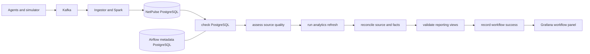

# Airflow orchestration

Apache Airflow is an optional control plane for NetPulse's existing daily
analytics job. It schedules dependency checks, source-quality classification,
the transactional analytics refresh, exact reconciliation, and reporting
validation. Kafka ingestion, Spark streaming, incident classification,
Prometheus, and Alertmanager continue independently when the `airflow` profile
is stopped.



The thin DAG at
`deployment/airflow/dags/netpulse_daily_reliability.py` delegates business
logic to `netpulse_analytics`. Airflow uses LocalExecutor and its own PostgreSQL
metadata database. The `netpulse_airflow` login can run analytics and write
orchestration state, but it is not a PostgreSQL administrator. Airflow's API is
bound to `127.0.0.1:8080`; the built-in SimpleAuthManager configuration is for
local development only.

## Schedule and date semantics

`netpulse_daily_reliability` runs at `02:00 UTC` (`0 2 * * *`). A scheduled run
selects the previous UTC calendar day from the data-interval end. `catchup` is
disabled and `max_active_runs` is one, so deployment does not automatically
enqueue history or overlap refreshes.

Manual runs may supply both `from_date` and `through_date` as ISO dates. The
range is inclusive and limited to 31 days. Supplying only one date, a reversed
range, or a longer range fails before analytics begins. Every selected date is
fully replaced inside the analytics transaction, making reruns and bounded
backfills replay-safe. The stable orchestration key is the DAG id plus date
range, so a rerun increments `attempt_count` instead of creating competing
status rows.

## Start, inspect, verify, and stop

Set non-default secrets in `.env` before use, then run one of the matching
operator commands:

| Action | Make / POSIX | PowerShell |
|---|---|---|
| Initialize metadata and credentials | `make airflow-init` | `./scripts/netpulse.ps1 airflow-init` |
| Start scheduler, DAG processor, and API | `make airflow-up` | `./scripts/netpulse.ps1 airflow-up` |
| Check DAG imports | `make airflow-test` | `./scripts/netpulse.ps1 airflow-test` |
| Execute the deterministic two-pass verifier | `make airflow-verify` | `./scripts/netpulse.ps1 airflow-verify` |
| Stop Airflow and preserve volumes | `make airflow-down` | `./scripts/netpulse.ps1 airflow-down` |

Open `http://127.0.0.1:8080`, or inspect without a browser:

```bash
docker compose --profile airflow ps
docker compose --profile airflow logs airflow-scheduler airflow-dag-processor
docker compose --profile airflow exec airflow-scheduler \
  airflow dags list-import-errors --output json
```

`airflow-verify` builds the images, applies migrations, starts healthy Airflow
services, inserts deterministic synthetic records through the real event
repository, waits for source visibility, executes the DAG twice for 2035-01-15,
and verifies non-empty facts, zero reconciliation mismatches, and at least two
attempts on one workflow key. It reserves source partition 99 and never resets
Kafka offsets, checkpoints, or PostgreSQL volumes.

## Configuration

Configure these values in `.env`; do not commit real values:

- `AIRFLOW_METADATA_DB_PASSWORD`: password for Airflow's separate metadata DB.
- `AIRFLOW_NETPULSE_DB_PASSWORD`: password for the least-privilege analytics login.
- `AIRFLOW_API_JWT_SECRET`: at least 64 random bytes for local API signing.
- `AIRFLOW_ADMIN_USERNAME`: local SimpleAuthManager administrator name.
- `AIRFLOW_UID`: container file owner, normally `50000`.
- `NETPULSE_AIRFLOW_STALE_AFTER_SECONDS`: allowed observation-versus-heartbeat gap.
- `NETPULSE_AIRFLOW_DELAY_AFTER_SECONDS`: maximum accepted ingestion delay.
- `NETPULSE_AIRFLOW_FAILURE_WEBHOOK_URL`: optional HTTP webhook for failures.

The webhook receives a small JSON failure envelope. Delivery failure is logged
but cannot hide the original task failure. Airflow and NetPulse database
passwords should differ outside a disposable local environment.

## Source quality and reconciliation

The source gate reads a repeatable, read-only snapshot for the requested UTC
window and classifies it as:

- `healthy`: typed observations exist within the configured freshness bounds;
- `delayed`: ingestion delay exceeds its grace period;
- `stale`: heartbeats continued after probe observations became stale;
- `missing`: raw activity or heartbeats exist but typed observations do not;
- `invalid`: source processing failures exist for the window;
- `legitimately_empty`: neither relevant observations nor upstream activity exist.

Only `healthy` and `legitimately_empty` windows may refresh. Empty periods are
therefore represented without inventing data, while contradictory evidence
fails the run. Data-quality failures are not retried indefinitely.

Reconciliation independently derives daily grains from deduplicated
`network_measurements` and `service_checks`, then compares counts, successes,
failures, latency sums/counts, packet-loss sums/counts, incident snapshots, and
reporting validity. A mismatch fails the DAG. The analytics refresh itself is
transactional, so a failed refresh does not leave a partial reporting window.
The latest result is visible in `v_analytics_workflow_status` and the existing
Grafana Pipeline Reliability dashboard.

## Manual backfill and retry

In the Airflow UI, trigger `netpulse_daily_reliability` with configuration such
as:

```json
{"from_date":"2026-10-01","through_date":"2026-10-07"}
```

For the CLI, run inside the scheduler container:

```bash
docker compose --profile airflow exec airflow-scheduler airflow dags trigger \
  netpulse_daily_reliability \
  --conf '{"from_date":"2026-10-01","through_date":"2026-10-07"}'
```

After repairing a dependency, clear only the failed task and its downstream
tasks in the UI, or trigger the same bounded range again. Do not delete source
events, reset offsets, clear Spark checkpoints, or remove NetPulse volumes as
a recovery step. Repeated successful execution replaces the same daily grains
and updates the stable status row.

## Failure runbook

1. Identify the failed task in the Airflow UI or scheduler logs.
2. Query `v_analytics_workflow_status` for `failed_task_id`, `error_type`, source
   classification, date range, and attempt count.
3. For `check_postgres`, restore PostgreSQL and confirm its health check before
   retrying. This transient task has two bounded retries.
4. For source-quality failures, inspect raw/typed counts, processing failures,
   heartbeats, and event/receive times. Correct the upstream issue; do not
   manufacture observations for an actually empty period.
5. For `run_analytics_refresh`, inspect the analytics exception and database
   transaction. It has two bounded retries and a 20-minute timeout.
6. For reconciliation or reporting failures, compare the selected UTC window
   with the documented analytics definitions. These permanent checks do not
   retry automatically.
7. Trigger or clear the same date range after repair, then confirm status is
   `success` and both mismatch counts are zero.

A scheduler restart is safe: the metadata database and logs are persistent,
and LocalExecutor resumes scheduling from stored state. `airflow-down` preserves
both volumes. Removing the Airflow metadata volume erases Airflow history and
must be an explicit operator decision; it does not erase NetPulse source data.

## Limitations

This deployment is a single-machine development topology, not a highly
available Airflow installation. It has one scheduler, one DAG processor, local
task execution, local persistent logs, no TLS, and local-only SimpleAuthManager.
The failure webhook is deliberately generic and unauthenticated unless the
configured endpoint provides its own protected URL. Airflow operational state
is exposed through PostgreSQL/Grafana rather than a second metrics stack. The
workflow does not orchestrate continuous Kafka/Spark services, automatically
repair bad data, or bypass the 31-day backfill limit.
