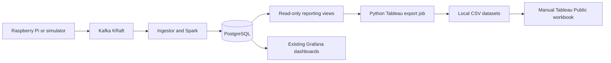

# Tableau BI Dashboard Export Design

**Date:** 2026-10-08  
**Branch:** `feature/tableau-bi-dashboard`  
**Base:** `origin/master` at `e64292f`

## Purpose

Add an optional Tableau Public reporting deliverable to NetPulse without changing
the live ingestion, streaming, classification, query API, Grafana, Prometheus, or
deployment paths. NetPulse will continue to run without Tableau. The new component
will turn existing read-only PostgreSQL reporting views into documented CSV datasets
that can be inspected before they are published through Tableau Public.

This feature is the first of two independent additions. A later Airflow feature may
orchestrate the existing analytics refresh, reconciliation, and this export command,
but the Tableau exporter will not depend on Airflow.

## Existing Constraints

- The analytics service already uses `NETPULSE_DATABASE_URL`, Psycopg, Python 3.12,
  Docker Compose, and one-shot commands.
- `v_daily_probe_reliability` exposes exact daily counts, percentage success,
  latency sums/counts and means, and packet-loss sums/counts and means. It does not
  expose percentiles.
- `v_incident_summary` exposes one row per incident, including modeled severity and
  confidence, but not individual affected agent or endpoint identifiers or evidence.
- `v_sre_agent_status` exposes agent role and current heartbeat state.
- `v_sre_pipeline_status` exposes one current pipeline-health snapshot.
- `v_grafana_live_measurements` exposes measurement-level data but includes target
  identifiers and is intended for live operational panels rather than a public BI
  extract.
- Existing reporting roles are read-only. PostgreSQL remains loopback-only and will
  not be exposed publicly.

## Selected Approach

Extend `services/analytics` with a focused `netpulse_analytics.tableau` package and a
`netpulse-tableau-export` console command. This reuses the repository's established
configuration, dependency, packaging, and Docker patterns instead of creating a
second database client application.

The exporter will query only existing reporting views. It will not add reporting
tables, alter analytics semantics, or read operational tables. SQL will perform
well-defined grouping and weighted aggregation; Python will normalize values,
pseudonymize identifiers, format CSVs, and publish the complete export atomically.

Alternatives rejected:

1. A separate `analytics/tableau` distribution would duplicate configuration,
   packaging, and image maintenance.
2. PostgreSQL `COPY` scripts would provide weaker transformation, privacy enforcement,
   testability, and multi-file publication behavior.
3. A direct Tableau-to-PostgreSQL connection would require database exposure and is
   incompatible with Tableau Public's public-data model and NetPulse's privacy posture.

## Architecture and Data Flow

Grafana remains the operational dashboard. Tableau is an optional downstream BI
consumer. Tableau does not consume Kafka, connect to PostgreSQL, or participate in
the live production path.

## Component Boundaries

### Configuration and CLI

The command will accept an explicit output directory, defaulting to
`tableau_exports`, and will obtain the database URL through the existing
`NETPULSE_DATABASE_URL` convention. Missing configuration and database failures will
produce a clear nonzero exit without modifying a prior valid export.

The command surface will include:

- `make tableau-export`
- `./scripts/netpulse.sh tableau-export`
- `./scripts/netpulse.ps1 tableau-export`
- direct `netpulse-tableau-export --output-dir <path>` use inside the analytics image

Docker Compose will mount the repository's generated-output directory into the
existing optional analytics service. Tableau will remain absent from CI and from all
core service startup dependencies.

### Repository Queries

One repository object will read the selected reporting views in a read-only,
repeatable-read transaction with the session time zone set to UTC. It will return
typed row structures rather than CSV strings. Query ordering and final Python sorting
will both be explicit.

The exporter will use:

- `v_daily_probe_reliability` for daily reliability and agent rollups;
- `v_incident_summary` for incident analysis;
- `v_sre_agent_status` only to associate an agent with its role;
- `v_sre_pipeline_status` for a point-in-time health snapshot.

`v_grafana_live_measurements` will not be exported. Its target identifiers are
unnecessary for the requested business questions, and its measurement-level volume
and privacy surface are larger than the curated daily facts. Consequently, p95
latency and exact most-recent observation timestamps will be omitted rather than
derived from a less suitable source.

### Transformation and Privacy

Raw agent identifiers will be replaced with stable pseudonymous keys computed as a
namespaced SHA-256 digest and truncated to a documented display length. The namespace
prevents the digest from being a plain hash of the identifier. Agent roles remain
available for wired-reference and Wi-Fi-observer comparisons. Display names,
endpoint/target identifiers, addresses, SSIDs, BSSIDs, environment variables, and
credentials will not appear in an export.

Pseudonymization reduces casual identification but does not make arbitrary real-world
data anonymous. Documentation will require users to inspect every CSV before public
publication and recommend using the deterministic simulator for portfolio work.

All percentages will use the 0-to-100 convention already established by
`success_rate_pct` and `mean_packet_loss_pct`. Latency and duration fields will retain
their documented millisecond units. Counts will remain integers. Null numeric values
will be emitted as empty CSV fields, never changed to zero.

## Dataset Contracts

Column order is part of each dataset contract.

### `daily_reliability.csv`

One row per UTC date, pseudonymous agent, source kind, and measurement type after
aggregating the endpoint grain from the reporting view:

1. `date_utc`
2. `agent_key`
3. `agent_role`
4. `source_kind`
5. `measurement_type`
6. `total_probes`
7. `successful_probes`
8. `failed_probes`
9. `success_rate_pct`
10. `average_latency_ms`
11. `average_packet_loss_pct`

Success rate is recalculated from summed counts. Average latency and packet loss are
calculated from summed numerators and denominators, not as averages of averages.
Rows sort by date, agent key, source kind, and measurement type. P95 latency is absent
because no selected reporting view supports it.

### `incidents.csv`

One row per incident, preserving the reporting-view grain:

1. `incident_id`
2. `incident_type`
3. `start_time_utc`
4. `end_time_utc`
5. `duration_ms`
6. `status`
7. `severity`
8. `confidence_score`
9. `rule_version`
10. `state_revision`
11. `affected_agent_count`
12. `affected_endpoint_count`

Rows sort by start time and incident ID. Timestamps use ISO 8601 with a `Z` suffix.
The exporter will not invent agent attribution, root-cause evidence, or additional
severity semantics.

### `agent_performance.csv`

One row per pseudonymous agent, role, source kind, and measurement type across the
available daily fact history:

1. `agent_key`
2. `agent_role`
3. `source_kind`
4. `measurement_type`
5. `first_observation_date`
6. `latest_observation_date`
7. `observation_day_count`
8. `total_probes`
9. `successful_probes`
10. `failed_probes`
11. `success_rate_pct`
12. `average_latency_ms`
13. `average_packet_loss_pct`

Incident count and exact latest observation time are omitted because they cannot be
derived accurately from the selected read-only views. Weighted calculations use the
same rules as the daily dataset.

### `pipeline_health.csv`

One snapshot row from `v_sre_pipeline_status`:

1. `observed_at_utc`
2. `last_raw_event_received_at_utc`
3. `raw_event_age_seconds`
4. `pending_dead_letter_count`
5. `stream_processing_failure_count`
6. `last_stream_batch_completed_at_utc`
7. `active_incident_count`
8. `pending_incident_publication_count`

This is a point-in-time export, not a historical time series. Tableau documentation
will not imply that a single row measures ingestion success or processing latency.

## Determinism, Consistency, and Atomic Publication

All four queries will execute in one read-only repeatable-read transaction so the
files represent one database snapshot. Transformations will deduplicate on each
documented output grain and fail on conflicting duplicate identities instead of
silently selecting a row.

The exporter will create a sibling staging directory on the same filesystem, write
all CSV files there with UTF-8 encoding, LF line endings, and deterministic headers
and row ordering, and close every file before publication. Publication will use a
directory swap:

1. Rename an existing output directory to a uniquely named backup.
2. Rename the complete staging directory to the requested output directory.
3. Restore the backup if the second rename fails.
4. Remove the backup only after the new directory is visible.

Failures before publication leave the previous export untouched. Temporary and
backup names will exclude credentials and will be cleaned up on best effort without
masking the primary failure.

## Demo Workflow

No sample CSV will be presented as production data. The documented free workflow will
use NetPulse's deterministic simulator and real reporting path:

1. Start the local stack and run deterministic simulator scenarios.
2. Run the classifier as needed for incident examples.
3. Run `analytics-all` to refresh reporting facts.
4. Run `tableau-export`.
5. Inspect the CSVs for privacy before opening Tableau Public.

The documentation will label the resulting data synthetic/demo data. Automated unit
tests will use small explicit fixtures solely to verify transformations, not to claim
representative network performance.

## Tableau Workbook Specification

`docs/tableau-dashboard.md` will describe four manually built dashboards:

1. **Executive Network Reliability** — success rate, incident count, supported
   latency and loss measures, and the reliability trend, filtered by date, agent,
   role, source kind, and measurement type.
2. **Incident Analysis** — incident category, duration, frequency, confidence,
   severity, time trend, Pareto-style category analysis, and detail table.
3. **Agent Performance** — wired/Wi-Fi or individual pseudonymous-agent comparison
   using reliability, latency, loss, and probe volume.
4. **Reliability Scorecard** — supported current values, trends, and carefully
   labeled portfolio objectives. The existing 99% ingestion, sub-second p95
   processing, and under-60-second freshness objectives will be described only where
   a dataset actually supports the measure, and never as production SLAs.

Relationships will be optional and conservative. Daily reliability and agent
performance may relate through `agent_key`, `source_kind`, and `measurement_type`.
Incidents have no valid per-agent relationship and must not be joined to agents.
Pipeline health is a standalone snapshot.

## Documentation and Architecture Changes

The README will gain a concise `Tableau BI Dashboard` section with the downstream
architecture, export command, documentation link, workbook URL placeholder, and note
that Tableau is optional. `docs/architecture.md` will show Tableau after the reporting
views and export job without replacing Grafana. `docs/tableau-dashboard.md` will hold
all detailed workbook, calculated-field, demo, publication, and privacy instructions.

The Tableau Public instructions will state that published workbooks and their data
are publicly accessible and must not contain home-network identifiers, private IPs,
SSIDs, BSSIDs, credentials, secrets, or personal information.

## Testing Strategy

Implementation will follow test-driven development. Unit tests will use fake or
mocked repository results and temporary directories; Tableau software is not needed.
Coverage will include:

- exact column order for every dataset;
- deterministic row ordering;
- count-based percentage and weighted-average calculations;
- UTC date and timestamp formatting;
- null-to-empty CSV behavior;
- duplicate output-grain rejection or collapse where rows are exactly equivalent;
- privacy-field exclusion and stable pseudonymous agent keys;
- clear configuration/database failure behavior;
- CSV encoding and generation;
- staging failure preserving the previous output;
- publication rollback when the final directory rename fails;
- CLI exit behavior and command wiring;
- Docker Compose validation with the optional analytics profile.

Targeted exporter tests, the existing non-integration suite, lint, type checking,
Compose configuration validation, and practical analytics integration verification
will be run before completion. Any skipped live-stack check will be reported with its
environmental reason.

## Airflow Integration Boundary

The later Airflow branch may invoke `netpulse-tableau-export` only after analytics
refresh and reconciliation succeed. Airflow will supply the same database environment
and output directory that a human or Compose command supplies; no Airflow imports or
credentials will enter the Tableau package. Airflow must treat CSV publication as an
idempotent downstream task and must not automate Tableau Public publication.

## Limitations

- P95 latency is not available in the selected curated reporting views.
- Incident-to-agent attribution and evidence are not available from
  `v_incident_summary`.
- Agent performance has a latest UTC date, not an exact latest observation timestamp.
- Pipeline health is a single export-time snapshot rather than retained history.
- Pseudonymization does not make arbitrary source data anonymous; human inspection is
  required before public publication.
- The repository supplies a workbook design and CSVs, not a committed Tableau workbook
  or automated Tableau Public publishing credentials.
