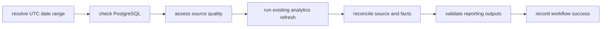

# Apache Airflow Orchestration Design

**Date:** 2026-10-09
**Branch:** `codex/airflow-orchestration`
**Base:** `origin/master` at `e64292f`

## Purpose

Add Apache Airflow as an optional orchestration layer for NetPulse's existing daily
analytics workflow. Airflow schedules, validates, runs, reconciles, and records the
batch; it does not replace Kafka, Spark, the incident classifier, Prometheus,
Alertmanager, Grafana, or the existing one-shot analytics CLI.

## Deployment

Pin `apache/airflow:3.3.2-python3.12` and extend it only with the local
`netpulse-analytics` package. Use LocalExecutor for this single-machine deployment.
The `airflow` Compose profile contains a dedicated PostgreSQL metadata database,
initializer, scheduler, DAG processor, and loopback-only API/UI server. Redis,
Celery, a triggerer, and remote workers are unnecessary for this DAG.

Airflow metadata uses its own database, login, password, and volume. DAG tasks use a
separate `netpulse_airflow` login provisioned idempotently against the NetPulse
database. That login receives only the operational reads and analytics writes needed
by the workflow. No Airflow service receives the NetPulse admin password.

## DAG

`netpulse_daily_reliability` runs at 02:00 UTC and processes the previous complete UTC
calendar day. It has `max_active_runs=1`, a one-hour DAG timeout, bounded task
timeouts, and catchup disabled by default. Manual runs may supply an inclusive
`from_date` and `through_date`; validation limits a run to 31 UTC dates. Historical
backfills remain explicit and bounded.

Task graph:

Database availability and analytics refresh receive two retries for transient
failures. Date validation, source-quality failures, reconciliation mismatches, and
reporting-contract failures are not retried automatically. The existing advisory
lock and transaction preserve non-overlap, rollback, and replay safety even during
manual reruns.

## Source Quality

The analytics package will inspect a requested half-open UTC window and classify it:

- `healthy`: typed probe observations exist and are current relative to observed
  agent activity;
- `delayed`: observations exist but ingestion delay exceeds the configured grace;
- `legitimately_empty`: there are no probe, relevant raw, heartbeat, or invalid-event
  signals in the window;
- `missing`: valid raw probe events or heartbeats exist but typed probes do not;
- `stale`: heartbeat activity continues materially after the most recent probe;
- `invalid`: ingestion failures occurred for relevant source topics.

Healthy, delayed, and legitimately empty windows may refresh. Missing, stale, and
invalid windows fail before analytics mutation. Every assessment is logged with
counts; no task deletes or repairs source data.

## Reconciliation and Reporting Validation

Reusable reconciliation code compares source and fact rows at the established UTC
date/agent/endpoint/source/probe grain, including total, success, failure, latency,
and packet-loss counts and sums. It also verifies the current incident snapshot and
bridge counts. Comparison uses the same deduplicated operational tables and event-time
semantics as the existing analytics refresh.

Reporting validation checks the reporting view's grain, count identities, percentage
range, nonnegative latency/loss, requested date coverage, and the successful
`analytics_job_runs` record. Any mismatch fails the DAG.

## Run State and Notification

An additive migration creates `analytics_orchestration_runs` and a read-only
`v_analytics_workflow_status` view. A run key is upserted, so clearing or rerunning a
task cannot duplicate workflow state. The final task records success; a DAG failure
callback records failure on a best-effort basis. Airflow task logs remain the detailed
execution record.

An optional `NETPULSE_AIRFLOW_FAILURE_WEBHOOK_URL` sends a small JSON failure notice.
No URL is committed, logged, or stored in PostgreSQL. Notification failure never
changes the original DAG failure.

Grafana gains one PostgreSQL-backed workflow-health panel using the read-only status
view. Airflow uses its native UI for task duration, retries, scheduling delay, and
logs; NetPulse does not introduce a competing metrics stack.

## Testing and Verification

Pure analytics tests cover date selection, all source classifications,
reconciliation, reporting validation, transient connection errors, idempotent run
state, and notification behavior. Deployment tests validate the optional profile,
separate metadata database, least-privilege credentials, loopback binding, DAG shape,
and operator commands. The Airflow image runs real DAG import checks.

The live acceptance workflow generates deterministic simulator traffic, runs the DAG
against the current UTC date, reruns the same logical work, and verifies reconciled
facts and a single upserted orchestration record. Existing non-Airflow commands remain
valid with the profile disabled.

## Limitations

- This is a single-machine portfolio deployment, not a highly available Airflow
  cluster.
- LocalExecutor scheduler restarts interrupt running tasks; retry or clear the failed
  task after the scheduler returns.
- Catchup is disabled to avoid accidental unbounded work; operators must request
  bounded backfills explicitly.
- The optional webhook is generic and best-effort; no external paging service is
  bundled.
